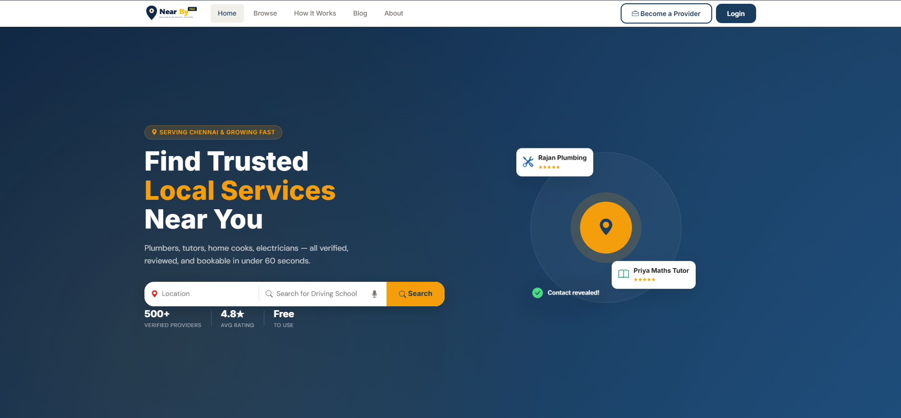
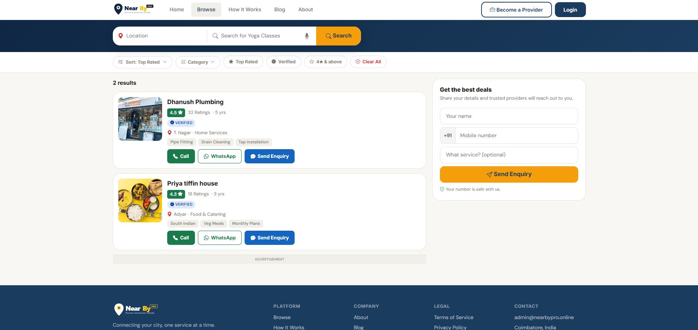
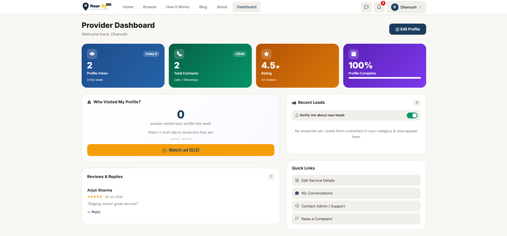
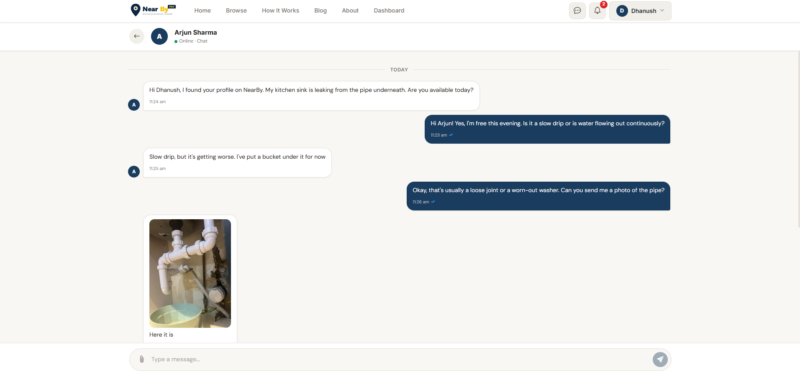
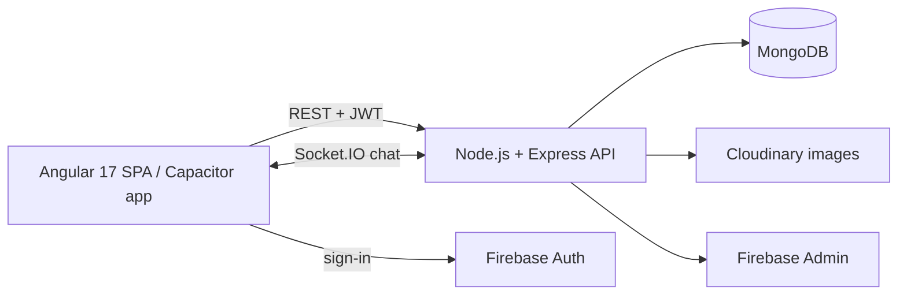

# NearByPro

> A hyperlocal services marketplace that connects customers with trusted local service providers — plumbers, electricians, tutors, salons, tiffin services and more.

<p align="center">
  
  
  
  
  
</p>

---

### 🌐 Live Demo

| Environment | URL |
|-------------|-----|
| Production | **[nearbypro.online](https://nearbypro.online/)** |
| Staging | **[nearby-client-staging.onrender.com](https://nearby-client-staging.onrender.com/)** |

**Demo logins (staging):**

| Role | Mobile | Password |
|------|--------|----------|
| Customer | `9100000001` | `Test@1234` |
| Provider | `9100000002` | `Test@1234` |

---

### 📸 Screenshots

| Home | Browse |
|---|---|
|  |  |

| Provider Profile | Real-time Chat |
|---|---|
|  |  |

---

### ✨ Features

- Browse local service providers by category and area
- Real-time chat between customers and providers (Socket.IO)
- Lead system — customers request services, providers respond
- Role-based dashboards for customers, providers, and admins
- JWT auth with access/refresh tokens and route guards
- Image uploads via Cloudinary
- Admin panel — approve providers, manage categories, handle complaints
- Mobile-ready with Capacitor and Bootstrap 5

---

### 🏗️ Tech Stack

**Frontend:** Angular 17 (standalone components, lazy loading), RxJS, Bootstrap 5, Socket.IO client, Firebase

**Backend:** Node.js, Express, MongoDB + Mongoose, Socket.IO, JWT, bcrypt, Multer + Cloudinary, Firebase Admin

**Testing & DevOps:** Playwright (E2E), GitHub Actions (CI/CD), Render, Docker

---

### 🧭 Architecture



---

### 🚀 Run Locally

**Prerequisites:** Node.js 22+, a MongoDB connection string (local or Atlas)

```bash
npm run install:all                       # installs root, server and client deps
cp server/.env.example server/.env        # fill in MongoDB URI, JWT secrets, Cloudinary keys
npm run seed                              # demo categories, providers and users
npm run dev                               # API on :5000, web app on :4200
```

**End-to-end tests (Playwright):**

```bash
npx playwright test
```

---

### ⚙️ CI/CD

GitHub Actions runs backend and frontend CI on every push. The CD workflows deploy to separate **staging** and **production** environments on Render.

---

### 👨‍💻 About the Builder

Built by **Dhineshkumar** — a full-stack engineer who enjoys building real-world products end-to-end, from database schema and REST API design to UI and deployment. NearBy covers the complete lifecycle: auth, real-time messaging, file uploads, geospatial queries, an admin moderation system, SEO, and cloud CI/CD.

[](mailto:dhineshdk024@gmail.com)
[](https://www.linkedin.com/in/dhineshkumara)
